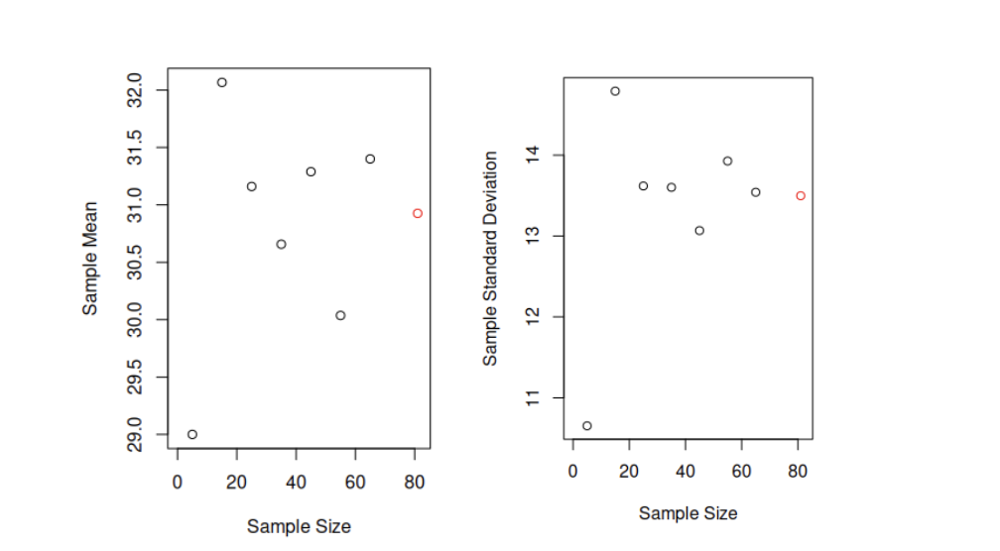

Question 1: What a Sample Statistic Actually Estimates: A population parameter and a sample statistic are often talked about as if they were interchangeable. Using this week's Notes on probability distributions, explain in your own words why a sample statistic is itself a random variable with its own distribution, not a fixed value, and why reporting a single computed value without any sense of its sampling variability can be misleading.

•       Give a concrete example, from medicine, public health, or another field of your choice, where treating a sample statistic as though it were the fixed population parameter would lead someone to overstate their confidence in a conclusion.

•       Explain what would need to be true about the sample for that overstatement to be especially severe, for example a small sample size or a highly variable underlying population.

Response Posts: Engage with the specific example a classmate gave, not just their general explanation.

•       Ask what they would expect to happen to the overstatement they described if the sample size were much larger.

•       Suggest a different real-world example where the same mistake would be even easier to make without noticing.

#----------------------------------

From this week's notes on probability distributions, I deduced that population parameter and sample statistic are not interchangeable though they are often talked about as if they were.
First, a population when talked about is referring to the entire collection of individuals or items or things. In order to talk about the population or describe aspects of it we employ descriptive summaries such as the mean/average or variance. These descriptive properties of the population are what gets called "population parameter". Which technically might be idealized summaries of the population as we may often never be able to know the population entirely. Nevertheless, population parameters or its corresponding probability distribution will be fixed as it represents the entirety of whatever is being considered. In the context of population parameters, the mean takes the symbol 𝜇, the variance takes the symbol 𝜎^2, and so on. While sample statistics have the same meaning but different symbols, x̄ and s^2 respectively.
On the other hand, sample statistic will refer to descriptive summaries of a sample; A portion or subset of a population taken for the purposes of statistical inference. Since these descriptive summaries are derived from a sample they will not perfectly reflect the population parameter but vary from sample to sample. This is same for its corresponding probability distribution as randomness of the sampling procedure introduces variability to the sample statistics.
In practical case, suppose a researcher computes the average income of a sample of 30 adults in a certain neighborhood and finds it to be $75,000. If this sample statistic is treated as the true population mean, then the researcher might conclude that the average income in the entire neighborhood is exactly $75,000, which is a wrong conclusion. In this case, the researcher relied on a single computed value from a specific location. An even severer case of overstatement will be that the researcher did not take the samples randomly( both high earner /low did not have equal chance of getting into the sample ) smaller sample size ( very few high earners could drive the average significantly higher ), other factors such as type of jobs that might be common in the neighborhood not taken into account, etc. Hence, treating this sample statistic as the population parameter will lead to overestimation of the average income in the entire neighborhood and the population at large. That wouldn’t be a good representation of what the true average income might be and could either be lower or higher.

-Martin

#-------------

#response

by Coddie Curry - Saturday, November 7, 2026, 10:26 AM
A sample statistic is itself a random variable with its own distribution, not a fixed value, because its value depends on which individuals happen to end up in the sample. The population parameter (for example, the true mean or true proportion) is fixed, even if we don’t know it, but every time we draw a new random sample we get a slightly different value of the statistic. If we repeated the sampling many times, those values would form their own distribution, called the sampling distribution, and its spread (the standard error) tells us how much the statistic is likely to vary from sample to sample. This variation can be seen in everyday sampling, such as polling election votes in specific regions or across demographics, or surveying population weight or general opinion; each new sample of people will give a somewhat different result even though the true population value hasn’t changed. The reading also suggested other reasonable examples, such as a radioactive source emitting N alpha particles within a 1-second window, or a call center receiving N calls within a given minute, which can vary depending on who calls and at what time. In both cases, N is a random variable because it changes from one window to the next, and if we averaged the counts over several windows to estimate the true rate, that average would also vary depending on which windows we happened to observe. Therefore, a sample statistic cannot be a fixed value, and reporting it as one can be misleading because it hides how different the result could have been with a different sample.

Establishing a sample statistic as a fixed value and not a random variable removes the likelihood of other possible values, which makes us more confident in the result than the data actually justify. An example of this would be if a geneticist were to consider patient X with sickle cell anemia, study the severity of their complications (such as how often they experience pain crises) and the factors that seem to drive them, and then make a determining decision for all patients based on patient X. Although every patient with sickle cell anemia carries the same underlying HBB mutation, the severity of the disease varies widely from patient to patient, partly due to modifying factors such as fetal hemoglobin levels. Therefore, this research and decision would be misleading, failing to consider that what drives complications for patient X may not be relevant to patient Y and patient Z. The same problem applies to a small study: if a researcher gave a treatment to 8 patients and found that pain crises dropped by an average of 50%, reporting “the treatment reduces crises by 50%” as if it were the population value would overstate their confidence, since a different group of 8 patients could easily show a 20% or 70% reduction. A sample statistic is useful in this instance when it is reported along with its standard error or a confidence interval, because it gives a generalized estimate across many patients along with an honest sense of how uncertain that estimate is.

This overstatement would be especially severe when the sample size is small, because the standard error shrinks as the sample size grows, so a small sample leaves much more room for the statistic to land far from the true value. It would also be severe when the underlying population is highly variable, as with sickle cell severity, because a larger spread in the population produces a wider sampling distribution at any sample size. Finally, it would be severe if the sample is not representative or the observations are not independent, for example, if most patients came from one specific location or region, shared similar environmental factors or demographics, or were related family members. In that case, the patients would tend to share the same influences, making one variable look more influential than it really is, and the sample would effectively contain less information than its size suggests.

Hello Coddie,

I think your post was very comprehensive, and your examples were very detailed to convey your points on this topic of sample statistics and population parameter. I found it helpful in understanding with your example of sickle cell anemia patients and how even though the gene mutation is the same across all patients, the disease severity varies widely due to other factors that need to be taken into account. The case of a single patient which is relatively a much smaller sample size when compared to the entire population of patients with sickle cell anemia is a good example of how sample statistics can vary widely from the true population parameter and would lead to overestimation of the disease severity in the entire population of patients with this gene mutation.

In your second example on pain crises reduction in 8 patients, highlighting the relationship between sample size and standard error is also very insightful. With regards to sample size, how many patients would you consider to be large enough in a study to minimize the standard error? You also point out factors such as sample representativeness and data independence as crucial elements. Will you consider them taking precedence over sample size? 

#-----------
by Charles-William Ruel - Saturday, November 7, 2026, 8:04 PM

A sample statistic it’s self is a random variable, as it can take on multiple different results when sampled repeatedly. As we saw in the weekly example that performed brute force resampling on the ALL dataset, there were 2491 samples taken that had a different mean than the original sampling. This sample statistic of 9 samples of men’s ages from the ALL dataset had a standard deviation of 11.55, whereas the population standard deviation was 13.50. As we can see the sample statistic here has a different mean and variance compared to the population dataset, even if it is pulled directly from the population. If we were to report just the mean of our sample subset (31.89) compared to the population mean (30.93), it is misleading as we can see there is a difference between the two means. However if we include standard deviations for each (11.55 and 13.50 respectively) we can see that the difference between sample and population (0.96) is well within one standard deviation.

An example where a sample population was used to make a conclusion on a population is the Steering Committee of the Physicians' Health Study Research Group, 1988 Asprin study, which had a sample population of 22,071 men. Half of the participants were given asprin, and the other half were given a placebo. The study showed a heart attack happened 1.7% of the time in placebo group, and only 0.9% in the treatment group, which corresponded to a calculated p-value of < .00001 (1). It was ultimately determined that the difference in heart attack rate had such a low magnitude (Δ=0.8%) that the sample size did not have enough power (<0.4) to make an inference on the population (1).

As we can see in men’s ages in the ALL dataset, as we increase sample size towards the population size (81 in this case), our mean and standard deviation values hone into the population mean and standard deviation (red point). But, in the case of a small sample size (points 1 and 2, n = 5,15) the mean and standard deviation are quite far from the population values. Thus in the case where we are trying to draw a conclusion for a population from a sample statistic, a small sample size can make the overstatement even more severe.

Citations:

Rosnow, R. L., & Rosenthal, R. (1989). Statistical procedures and the justification of knowledge in psychological science. American Psychologist, 44(10), 1276–1284. https://doi.org/10.1037/0003-066X.44.10.1276

Hello Charles,
Thanks for sharing your post. Your point regarding the sample statistics as a random variable is very clear and I agree with your statement that reporting just the mean of a sample subset can be misleading without the standard deviation. However, you also point out that even with the standard deviation, the sample statistic may still be far from the true population parameter, as evidenced by your example of the ALL dataset where the sample mean and standard deviation were quite far from the population values. 
For your example, "An example where a sample population was used to make a conclusion on a population is the Steering Committee of the Physicians' Health Study Research Group, 1988 Asprin study, which had a sample population of 22,071 men."
I believe you meant to simply say "sample" instead of "sample population"? since "sample" is already a subset of the population; otherwise, the statement would be redundant. But 
